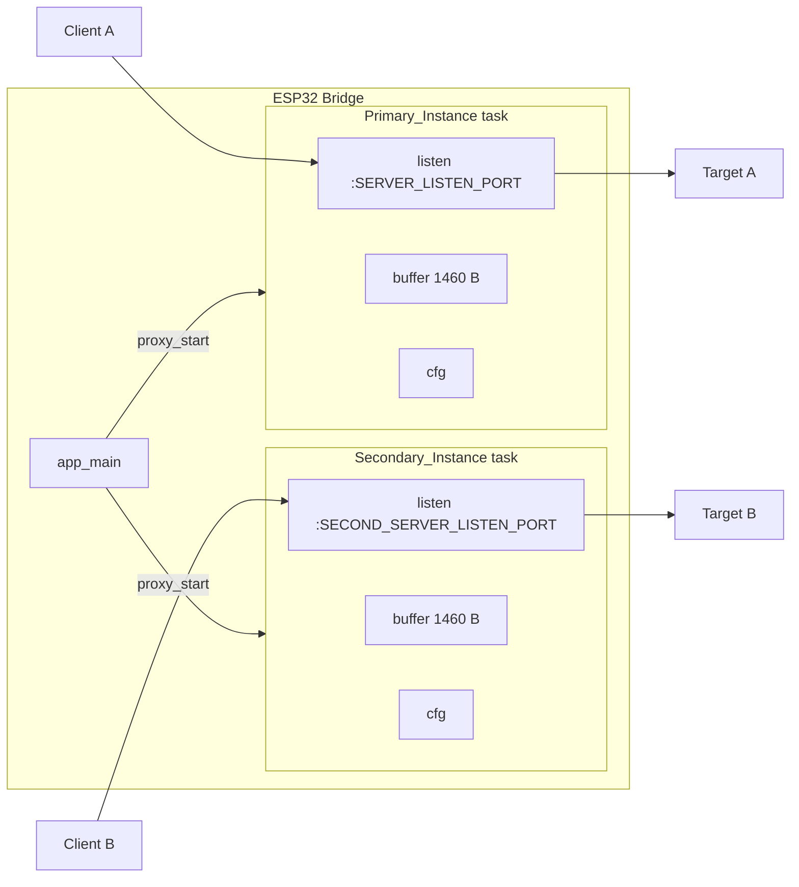
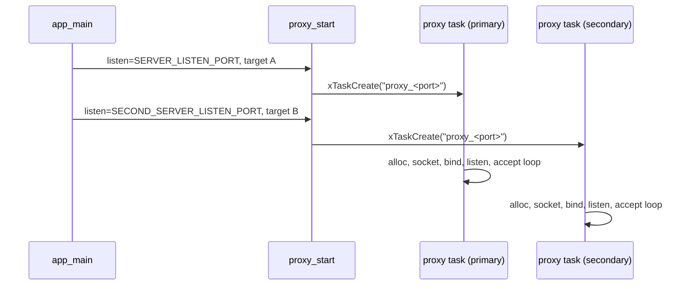

# Design Document

## Overview

The Bridge runs one TCP proxy task today. `app_main()` in `main/main.c` calls `proxy_start()` once with the `SERVER_LISTEN_PORT`, `PROXY_TARGET_ADDRESS` and `PROXY_TARGET_PORT` Kconfig values. This feature adds a Secondary_Instance, a second proxy task that listens on `SECOND_SERVER_LISTEN_PORT` (default 502, Modbus TCP) and forwards to `SECOND_PROXY_TARGET_ADDRESS`:`SECOND_PROXY_TARGET_PORT`.

The design is deliberately small:

- `proxy_start()` already allocates one task, one config struct and one 1460-byte buffer per call. Calling it twice therefore gives two isolated instances. No change to its signature (Requirement 5.2).
- `main/Kconfig.projbuild` and `main/Kconfig.projbuild.example` get a bool switch `SECOND_PROXY_ENABLE` (default `y`) and three new options that depend on it (Requirements 1, 2, 7).
- `main/main.c` calls `proxy_start()` a second time and adds `_Static_assert` checks for the port configuration, both inside `#if CONFIG_SECOND_PROXY_ENABLE` (Requirements 6, 7).
- `README.md` documents the new switch (Requirement 7.8).
- `main/proxy.c` gets small changes so that every log line carries the Listen_Port, each task has a distinguishable name, and startup failures are logged once with the failed step (Requirement 4.2, 4.5).

Key decisions and rationale:

| Decision | Rationale |
|---|---|
| Reuse `proxy_start()` and run one task per instance | Existing code already isolates config, buffer and sockets per call. Minimal risk of regression for the Primary_Instance. |
| Keep the 1460-byte buffer | A Modbus TCP frame is at most 260 bytes, so 1460 bytes is sufficient. The buffer is also unchanged for the Primary_Instance (Requirement 5.3). |
| Keep one client at a time per instance | Requirement 5.4 mandates this for the Primary_Instance. The Secondary_Instance uses the same code path. Modbus masters that need several simultaneous connections are out of scope. |
| Port checks as `_Static_assert` in C | Kconfig can bound a single value with `range`, but cannot express "symbol A differs from symbol B". The compiler can, and it also catches a hand-edited `sdkconfig`. See Components. |
| Optional via `SECOND_PROXY_ENABLE` (default `y`) | Deployments with one port avoid an unused task, buffer and listening socket. Default `y` keeps the behaviour of the already implemented feature. The switch is resolved by the preprocessor, so a disabled build contains no second-instance code. |
| No new proxy parameters in the public API | Per-instance state is derived from `listen_port`, which is already passed in. |

Research notes (from the existing code, nothing external was needed):

- Each `proxy_task` owns `cfg`, `buffer`, `listen_sock` and per-connection sockets. Nothing is global except the `const char *TAG`.
- `xTaskCreate()` copies the task name into the TCB, so a name built on the stack is safe.
- lwIP socket budget: each instance uses 1 listening socket plus 2 sockets while serving a client, so at most 6 sockets in total. This fits within the ESP-IDF default `CONFIG_LWIP_MAX_SOCKETS` of 10. I did not check the project's `sdkconfig` for an overridden value.
- Added memory cost for the second instance: one 4096-byte task stack, one 1460-byte buffer, one `proxy_config_t` (36 bytes before allocator overhead).

## Architecture



Startup sequence:



The two tasks share no state apart from the read-only `TAG` constant and the status LED driver (`led_set_*`). The LED calls are fire-and-forget and already used by the current proxy, so the second instance may overwrite the LED colour of the first. This is cosmetic and accepted.

Scheduling: both tasks run at `PROXY_PRIORITY` (5) and block in `accept()` or `select()`, so they yield the CPU when idle. Requirements 3.3 and 3.4 are met by task and socket independence. FreeRTOS time slicing between equal-priority tasks means throughput under saturation is shared, not strictly unchanged. The load of this bridge (small control frames) is far from that regime.

## Components and Interfaces

### 1. `main/Kconfig.projbuild` and `main/Kconfig.projbuild.example`

Add inside the "Ethernet & Proxy Settings" menu, after `PROXY_TARGET_PORT`, the switch and the three options that depend on it:

```kconfig
        config SECOND_PROXY_ENABLE
            bool "Enable Second Proxy"
            default y
            help
                Enable a second, independent proxy instance with its own listen port and target. When disabled, only the first proxy runs and the second proxy settings are hidden.

        config SECOND_SERVER_LISTEN_PORT
            int "Second Server Listen Port"
            depends on SECOND_PROXY_ENABLE
            default 502
            range 1 65535
            help
                The local port number (1-65535) on which the second proxy instance listens for incoming connections. Default 502 is the Modbus TCP port. Must differ from the Server Listen Port.

        config SECOND_PROXY_TARGET_ADDRESS
            string "Second Proxy Target Address"
            depends on SECOND_PROXY_ENABLE
            default "10.0.0.2"
            help
                The IP address or domain name of the remote target server for the second proxy instance.

        config SECOND_PROXY_TARGET_PORT
            int "Second Proxy Target Port"
            depends on SECOND_PROXY_ENABLE
            default 502
            range 1 65535
            help
                The port number (1-65535) of the remote target server for the second proxy instance.
```

- In the example file the only difference is `default "192.168.4.2"` for `SECOND_PROXY_TARGET_ADDRESS`, matching `PROXY_TARGET_ADDRESS` there (Requirements 1.5, 2.1, 2.2). `SECOND_PROXY_ENABLE` is identical in both files (Requirement 7.2).
- `depends on SECOND_PROXY_ENABLE` hides the three options in menuconfig when the switch is off. When the switch is off, Kconfig does not emit `CONFIG_SECOND_*` symbols into `sdkconfig.h`, so any C code that references them must sit inside `#if CONFIG_SECOND_PROXY_ENABLE` (Requirements 6.4, 7.3, 7.4).
- `range 1 65535` makes menuconfig reject out-of-range input and keep the old value (Requirement 1.6).
- Existing options stay untouched (Requirement 5.1).
- Because all options have defaults, a build without user-supplied values succeeds (Requirement 2.3).

Note on the existing files: the two files already differ in other places (Wi-Fi prompts, the "Status LED" menu exists only in `Kconfig.projbuild`). This design only adds the three options identically to both and leaves those differences alone.

### 2. `main/main.c`

Add compile-time checks and the second call. Everything that references a `CONFIG_SECOND_*` symbol is guarded:

```c
#define PORT_IN_RANGE(p) ((p) >= 1 && (p) <= 65535)

_Static_assert(PORT_IN_RANGE(CONFIG_SERVER_LISTEN_PORT),
               "CONFIG_SERVER_LISTEN_PORT must be in the range 1..65535");

#if CONFIG_SECOND_PROXY_ENABLE
_Static_assert(PORT_IN_RANGE(CONFIG_SECOND_SERVER_LISTEN_PORT),
               "CONFIG_SECOND_SERVER_LISTEN_PORT must be in the range 1..65535");
_Static_assert(CONFIG_SECOND_SERVER_LISTEN_PORT != CONFIG_SERVER_LISTEN_PORT,
               "CONFIG_SERVER_LISTEN_PORT and CONFIG_SECOND_SERVER_LISTEN_PORT must differ");
#endif

/* in app_main(), after the existing proxy_start() call */
#if CONFIG_SECOND_PROXY_ENABLE
proxy_start(CONFIG_SECOND_SERVER_LISTEN_PORT,
            CONFIG_SECOND_PROXY_TARGET_ADDRESS,
            CONFIG_SECOND_PROXY_TARGET_PORT);
#endif
```

A failed `_Static_assert` makes the compiler exit non-zero, so no firmware binary is linked (Requirements 6.1, 6.3). Equal valid ports give the "must differ" message; an out-of-range port gives a message naming the offending setting. When both ports are valid and different, nothing is emitted (Requirement 6.2). With the switch off, the preprocessor drops the second-port checks and the second call, so no second-port symbol is needed and only the Primary_Instance runs (Requirements 6.4, 7.5, 7.6, 7.7). The range check of the primary port stays unconditional because the primary proxy always runs.

### 5. `README.md`

Add a short section in the configuration documentation naming `SECOND_PROXY_ENABLE` (default `y`), explaining that it enables a second proxy instance, and listing `SECOND_SERVER_LISTEN_PORT` (default 502), `SECOND_PROXY_TARGET_ADDRESS` and `SECOND_PROXY_TARGET_PORT`, which are visible only when the switch is set (Requirement 7.8).

The comment "TODO: Make these configurable via menuconfig" above the first call becomes obsolete and is removed.

### 3. `main/proxy.h`

No change to the declaration. The doc comment may be extended to say that the function can be called several times for independent instances.

### 4. `main/proxy.c`

Changes are limited to logging and startup error reporting. Forwarding logic, timeouts (30 s inactivity, 5 s connect, 5 s stalled write, keep-alive 10/2/3) and the 1460-byte buffer stay as they are (Requirement 5.3).

- Per-instance logging: a small macro prefixes every message with the port, for example:

  ```c
  #define PLOGI(port, fmt, ...) ESP_LOGI(TAG, "[port %u] " fmt, (unsigned)(port), ##__VA_ARGS__)
  #define PLOGW(port, fmt, ...) ESP_LOGW(TAG, "[port %u] " fmt, (unsigned)(port), ##__VA_ARGS__)
  #define PLOGE(port, fmt, ...) ESP_LOGE(TAG, "[port %u] " fmt, (unsigned)(port), ##__VA_ARGS__)
  ```

  All `ESP_LOGx` calls in `proxy_task` use `cfg->listen_port`. `send_all()` gets an extra `uint16_t listen_port` parameter so its timeout warning is attributable too (Requirement 4.5). `proxy_start()` logs with its `listen_port` argument.
- Startup errors (Requirement 4.2): each failure point logs exactly one message naming the port and the step, then jumps to the existing cleanup labels:

  | Step | Message | Cleanup |
  |---|---|---|
  | allocation (buffer, or `socket()` creating the listener) | `[port N] startup failed: allocation (buffer)` / `(socket)` | frees what was allocated, `free(cfg)`, task deletes itself |
  | bind | `[port N] startup failed: bind (errno E)` | close listener, free buffer, free cfg |
  | listen | `[port N] startup failed: listen (errno E)` | same |

  Cleanup labels already release resources in reverse order. The failing task deletes itself; the other task is not touched (Requirement 4.4). `proxy_start()` allocation or `xTaskCreate` failure logs with the port and frees `cfg`.
- Task name: `proxy_start()` builds `"proxy_%u"` into a local `char name[16]` and passes it to `xTaskCreate()`. This makes the two tasks distinguishable in `vTaskList()` and the watchdog output.
- Connect timeout: the code keeps `SO_SNDTIMEO` of 5 s on the target socket. Requirement 5.3 fixes it to 5 s for the Primary_Instance and Requirement 3.6 asks for failure within 10 s. 5 s satisfies both, and both instances share the code path. On connect failure or timeout the task closes the client and target sockets and returns to `accept()` (existing behaviour). I have not verified on hardware that lwIP's `connect()` honours `SO_SNDTIMEO` for a blocking socket; this is an existing assumption of the current code.
- Connection cleanup (Requirements 4.3, 5.5): `shutdown()` plus `close()` of both sockets on every exit path of the forwarding loop is existing behaviour and completes well within 1 s.

## Data Models

```c
typedef struct {
    uint16_t listen_port;   /* also used as log/ task-name identifier */
    uint16_t remote_port;
    char     remote_ip[32];
} proxy_config_t;           /* unchanged */
```

Each `proxy_start()` call heap-allocates its own `proxy_config_t`, handed to its task, which frees it on exit. Each task allocates its own `uint8_t buffer[BUFFER_SIZE]` (1460 bytes) with `malloc`. No instance holds a pointer to another instance's data (Requirement 4.1).

Kconfig-derived constants used at build time:

| Symbol | Type | Default | Range |
|---|---|---|---|
| `CONFIG_SECOND_SERVER_LISTEN_PORT` | int | 502 | 1..65535 |
| `CONFIG_SECOND_PROXY_TARGET_ADDRESS` | string | "10.0.0.2" (example file: "192.168.4.2") | n/a |
| `CONFIG_SECOND_PROXY_TARGET_PORT` | int | 502 | 1..65535 |

Property-based testing does not apply to this feature, so there is no Correctness Properties section. The change consists of Kconfig declarations, build-time assertions, a second call that wires up existing code, and socket I/O with timeouts. None of these is a pure function with a meaningful "for all inputs" statement, and the forwarding path depends on lwIP sockets and real network peers. Example-based, build-level and integration tests fit better.

## Error Handling

| Condition | Behaviour | Requirement |
|---|---|---|
| Both listen ports equal | Compile error "must differ", no binary | 6.1 |
| A listen port outside 1..65535 | Compile error naming the setting | 6.3 |
| `SECOND_PROXY_ENABLE` off | Second-port checks and second `proxy_start()` call are compiled out; no second-port option needed | 6.4, 7.6 |
| Out-of-range value typed in menuconfig | menuconfig rejects it, previous value kept (Kconfig `range`) | 1.6 |
| Task creation or config allocation fails in `proxy_start()` | Log error with port, free `cfg`, return. The other instance is unaffected. | 4.2 |
| Buffer or listener socket allocation fails | One error log with port and step "allocation", release resources, task ends | 4.2 |
| `bind()` or `listen()` fails | One error log with port and step, release resources, task ends | 4.2 |
| Target IP string invalid | Log error, close client, keep listening (existing) | 3.6 |
| Target unreachable or connect timeout | Close client (and target socket), keep listening (existing) | 3.6, 5.5 |
| Peer closes, `select()` error, 30 s inactivity, stalled write | Close both sockets, resume `accept()` (existing) | 4.3, 5.5 |

A terminated instance never signals or restarts the other. They share no locks, queues or sockets.

## Testing Strategy

Property-based testing is not used (see Data Models for the reasoning). The tests below are example-based, build-level and integration tests.

Build tests (host, using `idf.py build`):

1. Default configuration builds with exit code 0 (Requirements 2.3, 6.2).
2. Equal ports: set `CONFIG_SECOND_SERVER_LISTEN_PORT` equal to `CONFIG_SERVER_LISTEN_PORT` through an sdkconfig override and confirm a non-zero exit, no `.bin` produced and the "must differ" message (Requirement 6.1).
3. Out-of-range port (for example 0 or 70000, set by editing `sdkconfig` directly because menuconfig refuses it): non-zero exit and a message naming the setting (Requirement 6.3).
4. Both Kconfig files: confirm the three new options exist with identical names, types, ranges, prompts and help, and the expected defaults (Requirements 1.1 to 1.5, 2.1, 2.2). A small script comparing the two files' new blocks is enough.
5. `proxy_start` signature unchanged: the build itself covers this because `main.c` calls it with the old argument list (Requirement 5.2).
6. Switch disabled: build with `CONFIG_SECOND_PROXY_ENABLE` unset (sdkconfig override `# CONFIG_SECOND_PROXY_ENABLE is not set`) and confirm exit code 0, even when the equal-port case would otherwise fail, and that `main.c` compiles without any `CONFIG_SECOND_*` symbol (Requirements 6.4, 7.6).
7. Switch enabled by default: a default build has `CONFIG_SECOND_PROXY_ENABLE=y` in `sdkconfig` (Requirement 7.1).
8. Kconfig comparison script also checks `SECOND_PROXY_ENABLE` (type bool, default y) and the `depends on SECOND_PROXY_ENABLE` lines in both files (Requirements 7.1, 7.2).

Integration tests on hardware (manual, with `nc` or a Modbus client and two echo servers as targets):

1. Both ports accept connections within 5 s of obtaining a network connection (Requirements 3.1, 3.2).
2. Echo a known byte sequence, including all 256 byte values and a 260-byte Modbus-sized frame, through each port and compare (Requirements 3.5, 5.4).
3. Hold a connection open on one port while connecting and transferring on the other; neither is disturbed (Requirements 3.3, 3.4).
4. Point one target at an unreachable address: its client is closed, its port keeps listening, the other port keeps working (Requirements 3.6, 4.4).
5. Occupy one listen port before startup is not possible on the ESP32 itself, so exercise the bind/listen error path by temporary code or a unit-level mock of `bind()`. Confirm exactly one error log naming the port and the step, and that the other instance runs (Requirement 4.2).
6. Close a client mid-transfer and check both sockets are released within 1 s and the other instance is unaffected (Requirement 4.3).
7. Inspect the serial log: every proxy line contains `[port N]` (Requirement 4.5).
9. Switch disabled on hardware: only the primary port accepts connections, the second listen port refuses connections, and the serial log shows no `[port <second>]` lines (Requirements 7.6, 7.7).
8. Regression for the Primary_Instance with the second one idle: inactivity timeout at 30 s, resume accepting within 1 s after close (Requirements 5.3 to 5.5).

Not verified by this design: actual throughput under heavy load on both ports, lwIP `connect()` timeout behaviour on the target hardware, and the project's effective `CONFIG_LWIP_MAX_SOCKETS`. The integration tests above should be run on the device to confirm them.
