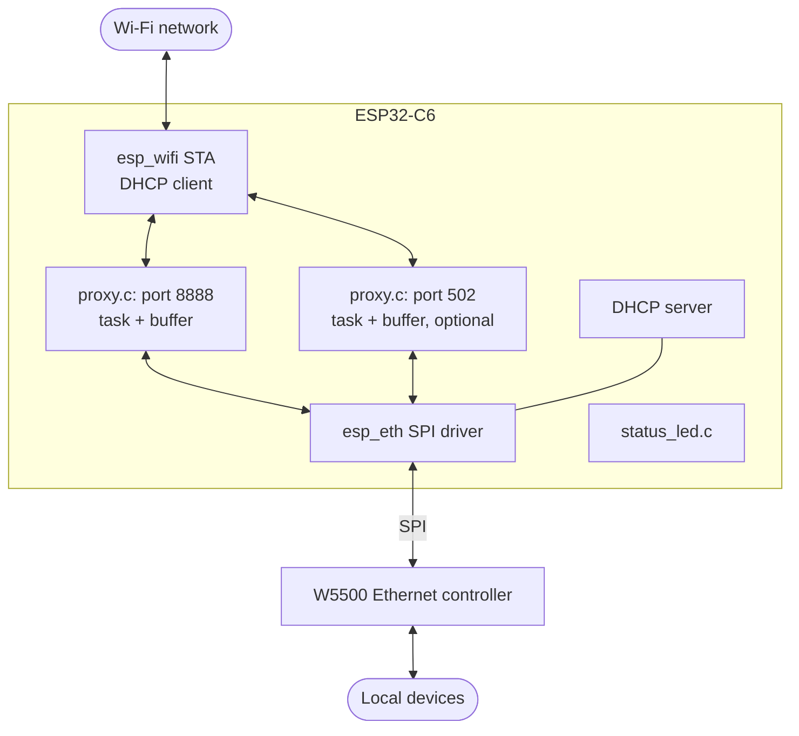
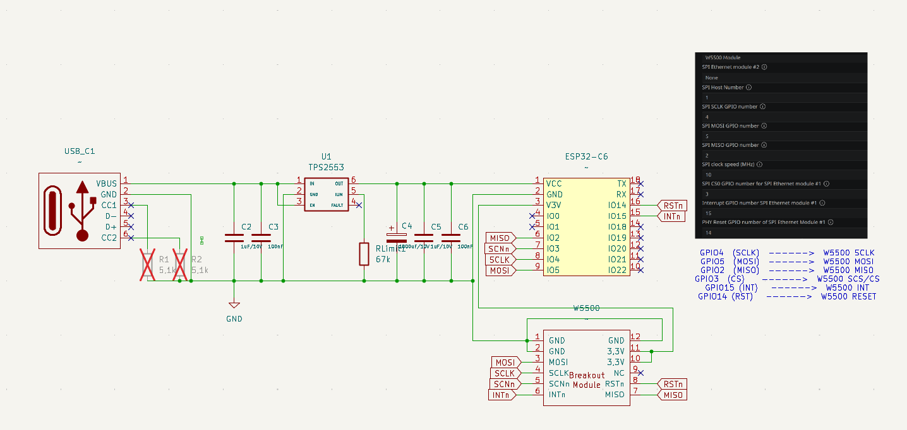
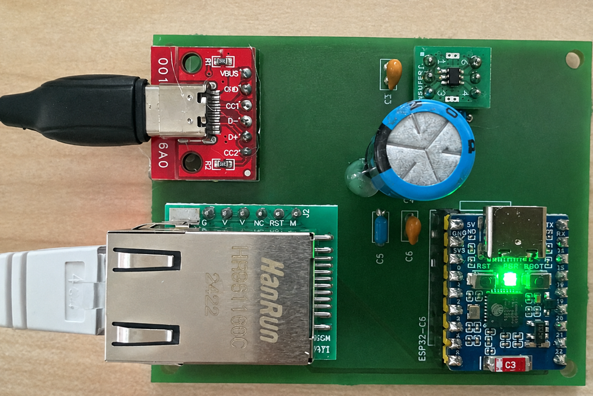

# esp32-wifi-eth-gateway
Proof-of-concept Wifi ⇄ Ethernet gateway running on an ESP32-C6.

## Hardware
- Waveshare ESP32-C6-Zero (or compatible ESP32-C6)
- WIZnet W5500 SPI Ethernet module (or compatible SPI Ethernet adapter)

## Project summary
This project implements a network gateway that forwards traffic between the ESP32's Wi‑Fi interface and a SPI‑based Ethernet interface. It can be used to bridge devices on an Ethernet subnet onto a Wi‑Fi network (or vice versa) for testing, prototyping, and embedded networking research. The implementation uses ESP-IDF networking components and the W5500 driver included as a component.

## Features
- Bridge packets between Wi‑Fi and Ethernet interfaces
- Uses ESP‑IDF networking stack
- Configurable via `menuconfig` / `sdkconfig`
- Example application code in `main/` (`main.c`, `proxy.c`)
- Wifi runs as DHCP client
- Ethernet run as DHCP Server
- TCP proxy on port 8888, plus an optional second independent proxy (default port 502 for Modbus TCP) that can be switched on or off with `SECOND_PROXY_ENABLE`, each with its own target

## Repository layout
- `main/` — application source and component Kconfig
- `partition_table/`, `sdkconfig*` — project configuration
- `managed_components/` — included external components (W5500, ethernet init, etc.)
- `build/` — build output (ignored by source control)
- `circuit-design` KiCad 9 project

## Requirements
- ESP-IDF (supported version: refer to the `esp-idf/` subfolder or `CMakeLists.txt`)
- A toolchain for the target (e.g. for ESP32‑C6)
- `idf.py` (part of ESP‑IDF)

## Quick build & flash
1. Set up ESP‑IDF and toolchain, then source the environment (example):

```bash
. $HOME/esp/esp-idf/export.sh
```

2. (Optional) set the target if needed:

```bash
idf.py set-target esp32c6
```

3. Create `main/Kconfig.projbuild` from the template (see "Create your own configuration") and configure project options (wifi credentials, ethernet pins, etc.):

```bash
idf.py menuconfig
```

4. Build, flash and monitor:

```bash
idf.py build
idf.py -p /dev/ttyUSB0 flash monitor
```

Replace `/dev/ttyUSB0` with your serial device.

## Create your own configuration
The project settings (Wi-Fi credentials, Ethernet addressing, proxy ports and targets) are defined in `main/Kconfig.projbuild`. That file is listed in `.gitignore`, so your credentials stay out of the repository. The repository only contains the template `main/Kconfig.projbuild.example`. Before the first build, create your own file from it:

1. Copy the template:

```bash
cp main/Kconfig.projbuild.example main/Kconfig.projbuild
```

2. (Optional) edit the `default` values in `main/Kconfig.projbuild`, for example `WIFI_SSID`, `WIFI_PASSWORD`, `ETHERNET_IP` and the proxy targets. You can also leave the defaults and set everything in step 3.

3. Open menuconfig and check or change the values under "Project Network Configuration":

```bash
idf.py menuconfig
```

   - "Wi-Fi Settings": `WIFI_SSID`, `WIFI_PASSWORD`
   - "Ethernet & Proxy Settings": Ethernet IP, netmask and gateway, the first proxy, and the optional second proxy (`SECOND_PROXY_ENABLE`)

4. Build and flash as described in "Quick build & flash".

Notes:
- Without `main/Kconfig.projbuild` the `CONFIG_*` options used by `main.c` are missing and the build fails.
- Values you set in menuconfig are stored in `sdkconfig`, which takes priority over the `default` values in `Kconfig.projbuild`. If you change a `default` later and the old value is still used, change it in menuconfig, or delete `sdkconfig` and run `idf.py reconfigure`. Note that deleting `sdkconfig` resets all of your settings.
- If you add or rename options in `main/Kconfig.projbuild`, run `idf.py reconfigure` so `sdkconfig` picks them up.
- When the template changes in the repository (new options), compare it with your copy, for example with `diff main/Kconfig.projbuild.example main/Kconfig.projbuild`, and add the new options to your file.
- Do not commit `main/Kconfig.projbuild` or `sdkconfig` if they contain real passwords.

## Configuration notes
- Wi‑Fi credentials and runtime options can be set in `menuconfig` or stored in `sdkconfig`/`sdkconfig.defaults` depending on how the project exposes them.
- Hardware pin mappings for the SPI Ethernet module are configured in `menuconfig` or in the ethernet component source — check `managed_components/espressif__w5500/` for driver-specific settings.

## Proxy configuration
The firmware runs two independent TCP proxy instances. Each one listens on its own port and forwards traffic to its own target. Both are set in `idf.py menuconfig` under "Ethernet & Proxy Settings":

| Option | Default | Purpose |
|---|---|---|
| `SERVER_LISTEN_PORT` | 8888 | Listen port of the first proxy |
| `PROXY_TARGET_ADDRESS` | 10.0.0.2 | Target IP or host of the first proxy |
| `PROXY_TARGET_PORT` | 8888 | Target port of the first proxy |
| `SECOND_PROXY_ENABLE` | y | Switch that enables the second proxy |
| `SECOND_SERVER_LISTEN_PORT` | 502 | Listen port of the second proxy (Modbus TCP) |
| `SECOND_PROXY_TARGET_ADDRESS` | 10.0.0.2 | Target IP or host of the second proxy |
| `SECOND_PROXY_TARGET_PORT` | 502 | Target port of the second proxy |

Notes:
- The second proxy is optional. `SECOND_PROXY_ENABLE` defaults to `y`. The three options `SECOND_SERVER_LISTEN_PORT` (502), `SECOND_PROXY_TARGET_ADDRESS` (10.0.0.2) and `SECOND_PROXY_TARGET_PORT` (502) are visible in `menuconfig` only when the switch is set. When it is unset, only the first proxy is started and the second-port checks are skipped.
- Ports must be in the range 1 to 65535.
- The two listen ports must differ. With `SECOND_PROXY_ENABLE` set, the build fails with a compile-time error if they are equal or out of range. With it unset, only the first port is checked.
- Each proxy serves one client at a time. The two proxies run in parallel and do not affect each other.
- Log lines are prefixed with `[port N]` so you can tell the two proxies apart.
- `main/Kconfig.projbuild.example` is a template with placeholder values. See "Create your own configuration" for how to copy it to `main/Kconfig.projbuild`.

## Wiring (ESP32 → W5500)
Below are the SPI pin assignments used in this project.

| Signal | ESP32-C6 pin | W5500 pin | Direction | Kconfig option |
|---|---|---|---|---|
| SCLK | GPIO4 | SCLK | ESP32 → W5500 | `CONFIG_ETHERNET_SPI_SCLK_GPIO=4` |
| MOSI | GPIO5 | MOSI | ESP32 → W5500 | `CONFIG_ETHERNET_SPI_MOSI_GPIO=5` |
| MISO | GPIO2 | MISO | W5500 → ESP32 | `CONFIG_ETHERNET_SPI_MISO_GPIO=2` |
| CS (CS0) | GPIO3 | SCS | ESP32 → W5500 | `CONFIG_ETHERNET_SPI_CS0_GPIO=3` |
| INT | GPIO15 | INT | W5500 → ESP32 | `CONFIG_ETHERNET_SPI_INT0_GPIO=15` |
| PHY_RST | GPIO14 | RESET | ESP32 → W5500 | `CONFIG_ETHERNET_SPI_PHY_RST0_GPIO=14` |

**Architecture**

- **Overview:** The ESP32 runs a small application that bridges packets between the Wi‑Fi stack (`esp_wifi` / `lwIP`) and a SPI Ethernet controller (W5500). The user-space TCP proxy (`proxy.c`) accepts connections on the ESP32 and forwards bytes between the two interfaces.

- **Responsibilities:**
	- `main.c` — initialises Wi‑Fi, Ethernet and starts the first proxy instance and, if `SECOND_PROXY_ENABLE` is set, the second one.
	- `proxy.c` — accepts TCP connections and forwards traffic between endpoints. `proxy_start()` is called once per enabled port.
	- `status_led.c` — indicates general on status and traffic activity (Ethernet/Wi‑Fi).

Architecture diagram:



Note: If you change these pins via `menuconfig`, update `sdkconfig` and re-flash the firmware so the driver uses the new assignments.


## Circuit Design
I create a KiCad 9 project with some custom footprints for the following components I used `circuit-design`:
* Waveshare ESP32-C6-Zero with headers
* TPS2553 USB eFuse on DIP-6 Adapter (Powerlimit 400mA)
* Wiznet 5500 module with headers
* generic USB-C Header which included termination resistors






## License & contributors
See the `LICENSE` file for license details. Contributions and issues are welcome.
